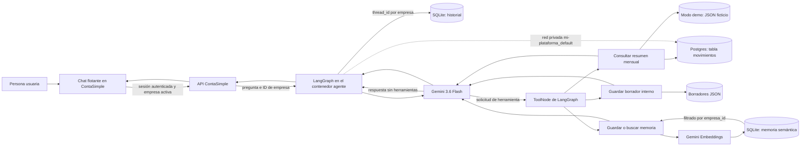

# Arquitectura del agente

## Separación por empresa

Cada conversación usa un `thread_id` asociado al ID de la empresa. La API valida la sesión y comprueba que la empresa exista antes de enviar la pregunta al servicio interno del agente. Las memorias semánticas se guardan con `empresa_id`, y las búsquedas filtran por la empresa activa. En modo ContaSimple, la consulta Postgres filtra por el ID activo y fuerza `default_transaction_read_only`.

## Decisiones del equipo

[Completar con el análisis y la justificación técnica propia del equipo.]
